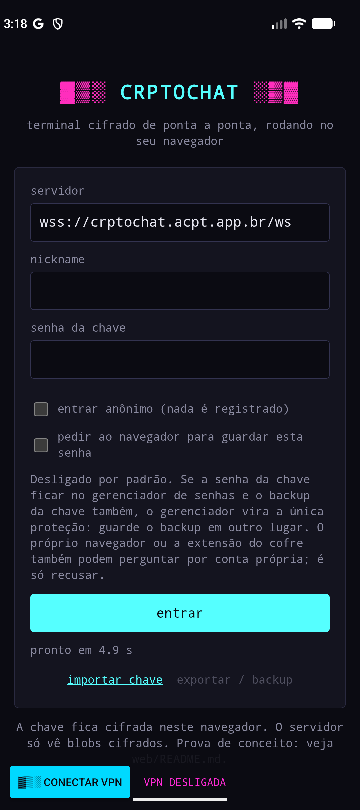

<div align="center">

```
╔══════════════════════════════════════════════════════════════╗
║  ▓▒░ CRPTOCHAT // MOBILE STACK ░▒▓                           ║
║  > o terminal cifrado agora cabe no seu bolso                 ║
╚══════════════════════════════════════════════════════════════╝
```

[](LICENSE)
[](app/build.gradle.kts)
[](#build)
[](#conex%C3%A3o)


<br>

**Cliente Android open-source do Crptochat — a stack mobile de comunicação com
[`hacking-table/crptochat-oss`](https://github.com/hacking-table/crptochat-oss/).**

</div>

---

## ▓▒░ SCREENSHOT // RODANDO NO MOBILE ░▒▓

<div align="center">



<br>

<sub>`emulator-5554` · Android 16 · `wss://crptochat.acpt.app.br/ws` · cliente web `pronto em 7.9 s`</sub>

</div>

---

## ▓▒░ O QUE É ISSO ░▒▓

Este app é uma **camada mobile enxuta** sobre o projeto original. Ele abre o
cliente web publicado pelo `crptochat-oss` em um WebView restrito e conversa com
o mesmo relay por WebSocket.

> [!IMPORTANT]
> Aqui **não há reimplementação** de protocolo, cifra ou servidor. Double
> Ratchet, pós-quântico, canais, voz e arquivos continuam sendo feitos pelo
> cliente do [`crptochat-oss`](https://github.com/hacking-table/crptochat-oss/).
> Este repositório só entrega a integração Android: origem fixa, endpoint
> WebSocket, ícone, build e permissões mínimas.

```
   ┌────────────────────┐       wss://crptochat.acpt.app.br/ws       ┌────────────────────┐
   │  CRPTOCHAT ANDROID │  ───────────────────────────────────────▶  │  RELAY / OSS       │
   │  WebView + CSP     │  ◀───────────────────────────────────────  │  blobs cifrados    │
   └────────────────────┘       o servidor não lê o texto           └────────────────────┘
```

| Item | Valor |
| --- | --- |
| Projeto de origem | [hacking-table/crptochat-oss](https://github.com/hacking-table/crptochat-oss/) |
| Página carregada | `https://crptochat.acpt.app.br/web/` |
| Endpoint fixado | `wss://crptochat.acpt.app.br/ws` |
| API | `minSdk 26` · `compileSdk/targetSdk 36` |
| Permissões | nenhuma de câmera, microfone, arquivos ou localização |
| Ponte JavaScript | nenhuma |
| VPN | WireGuard userspace, manual, perfil importado pelo usuário |
| Licença | MIT |

---

## ▓▒░ FEATURES // O QUE O APP FAZ ░▒▓

- Conexão **wss** já configurada no build — sem digitar endereço.
- O endpoint é fixado no `localStorage` da página via *document-start script*:
  uma URL salva em outro teste não redireciona o chat silenciosamente.
- WebView com allowlist de origem: navegação externa, `file://`, conteúdo
  misto, certificados inválidos e permissões web são bloqueados.
- Handshakes `ws:` / `wss:` e `Upgrade: websocket` **não são interceptados**.
- Botão de voltar integrado (`OnBackPressedCallback`).
- Ícone cyberpunk: balão neon com prompt `>_`, glitch magenta e grade de
  terminal — adaptive, round, legacy e monochrome (tema Android 13).
- Gerador de ícones reproduzível, sem dependência de PIL.
- **VPN WireGuard manual**: botão `▓▒░ CONECTAR VPN` na barra inferior.

---

## ▓▒░ VPN // WIREGUARD ░▒▓

O app embute o tunnel userspace oficial do WireGuard
(`com.wireguard.android:tunnel`) e conecta **somente quando o usuário pede**:

1. Toque em `▓▒░ CONECTAR VPN`.
2. O Android pede a autorização padrão de conexão VPN (uma única vez).
3. Escolha um arquivo `.conf` de configuração WireGuard.
4. O botão passa a `DESCONECTAR VPN` e o status mostra `VPN ATIVA · wg0`.

<details>
<summary><b>Por que importar o perfil?</b></summary>

Nenhuma chave privada ou endpoint de VPN é embutido no APK. O arquivo é lido
pelo Android via *content provider* e usado apenas na memória para abrir o
túnel. Depois de desconectar, a configuração não é salva pelo app.

</details>

> [!IMPORTANT]
> O endpoint do chat continua fixo em `wss://crptochat.acpt.app.br/ws`. A VPN
> muda a rota de rede, não o destino do WebSocket. Se o túnel estiver ativo,
> todo o tráfego do WebView passa por ele.

> [!WARNING]
> Para publicar na Play Store, declare o uso de VPN no Play Console e mantenha
> a política de privacidade atualizada. O diálogo de consentimento do Android
> é obrigatório e não pode ser suprimido.

---

## ▓▒░ BUILD ░▒▓

O padrão já aponta para a instalação pública:

```powershell
./gradlew assembleDebug
```

Abra o projeto no Android Studio e rode em um dispositivo com Android 8.0 ou
superior. Para distribuir, gere o bundle:

```powershell
./gradlew bundleRelease
```

### Conexão

Se precisar apontar para outra instalação, sobrescreva **os dois valores
juntos** (página e WebSocket devem estar no mesmo host/porta por causa da CSP):

```powershell
./gradlew assembleDebug `
  -PchatOrigin=https://outro.exemplo.org/web/ `
  -PchatWsUrl=wss://outro.exemplo.org/ws
```

### Testar no emulador (localhost)

Use `adb reverse` para que `localhost` dentro do emulador chegue à máquina que
roda o servidor — **não use `10.0.2.2`**: a CSP do cliente web e o
`--ws-origin` do servidor aceitam apenas `localhost` quando a página é HTTP.

```powershell
./gradlew assembleDebug -PchatOrigin=http://localhost:8123/ -PchatWsUrl=ws://localhost:7778

$adb = "$env:LOCALAPPDATA\Android\Sdk\platform-tools\adb.exe"
& $adb reverse tcp:8123 tcp:8123
& $adb reverse tcp:7778 tcp:7778
```

Na máquina, a partir de `crptochat-oss/`:

```powershell
python -m http.server 8123 --bind 127.0.0.1 --directory web/dist
crptochat-server --no-tls --ws-port 7778 --ws-origin http://localhost:8123
```

> [!WARNING]
> Sem `--ws-port`, o relay não cria a entrada WebSocket e a tela termina em
> "falha ao conectar servidor (WebSocket)".

---

## ▓▒░ ESTRUTURA ░▒▓

```text
cptochat-android/
├── app/
│   ├── build.gradle.kts          # chatOrigin / chatWsUrl, API 36
│   └── src/main/
│       ├── AndroidManifest.xml
│       ├── java/.../MainActivity.kt   # WebView, CSP, pin do WS, VPN WireGuard
│       └── res/mipmap-*              # ícone cyberpunk
├── docs/screenshots/app-main.png       # print real do app rodando
├── tools/generate_icons.py             # regera os PNGs do ícone
└── LICENSE                             # MIT
```

Para regenerar os PNGs do ícone:

```powershell
python tools/generate_icons.py
```

---

## ▓▒░ NOTE ░▒▓

O projeto depende do cliente web publicado pelo projeto principal. Antes de
distribuir, conclua os requisitos de integridade e auditoria descritos em
`crptochat-oss/web/README.md`.

---

## ▓▒░ LICENSE ░▒▓

[MIT](LICENSE) · Copyright (c) 2026 Vulcan-Defense

> Projeto aberto, feito para a comunidade do
> [crptochat-oss](https://github.com/hacking-table/crptochat-oss/).
> `>_` fim da transmissão.
